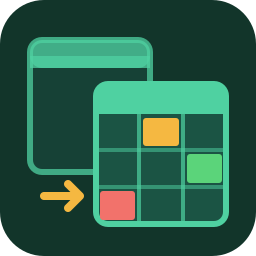

# Excel Compare & XLSX Diff (Compare Excel Files, CSV Diff, Spreadsheet Compare)

Excel compare for VS Code. Compare two Excel workbooks or CSV files cell by cell and see which rows were added or removed, which cells changed, and which sheets exist in only one file. Compare a workbook with its Git HEAD version before you commit.

## How to compare

- Select two files in the Explorer, right-click and pick Compare Selected Excel Files.
- Right-click one file, pick Compare with... and choose the other one.
- Right-click a file in a Git repository and pick Compare with Git HEAD.
- Or run Excel Compare: Compare Two Excel or CSV Files... from the command palette.

File types: .xlsx, .xlsm, .xls, .ods, .csv and .tsv, in any mix (an .xlsx against a .csv works).

## What you see

- Changed cells in yellow, with the old value struck through next to the new one. Added rows in green, removed rows in red.
- Rows are lined up, not compared line by line. A row inserted near the top does not mark every row below it as changed.
- Columns are matched by their header row, so a column inserted in the middle shows as one added column.
- Sheets are matched by name, then by position. Sheets in only one file are listed as added or removed.
- A tab per sheet with the number of differences, and a summary line for the whole workbook.
- Next and Previous change (N and P keys) jump through all changes, across sheets.
- Values or Formulas: compare what the cells show, or compare the formulas themselves.
- Click a cell to see its full old and new value and copy them.
- Notes when merged cells differ or when a limit cut a sheet.

## Big and broken files

The grid draws only the rows on screen, so a sheet with 300,000 rows scrolls like a short one. Reading and comparing run in a separate worker thread with a memory cap and a time limit, so a broken or hostile file cannot freeze VS Code.

Limits, each with a note in the view when it applies: 200 MB per file (setting excelCompare.maxFileSizeMB), 300,000 rows per sheet (excelCompare.maxRows), 1,000 columns, 200 sheets. A workbook whose zip parts would inflate to more than 600 MB, or that is compressed like a zip bomb, is refused before it is unpacked. A CSV file is read as a stream and stops at the row limit.

## CSV diff

CSV and TSV files are read with their encoding detected (UTF-8 with or without BOM, UTF-16, Windows code pages) and their delimiter detected (comma, semicolon, tab or pipe). Quoted fields with commas, quotes and line breaks inside are handled. A CSV file compares like a workbook with one sheet.

## Zovo Pro tools

Three tools for regular comparison work. Each has 3 free tries on your computer; a try is used only when the tool produced its result.

- Export a diff report: an XLSX workbook with the changed, added and removed cells filled in colour, a Summary sheet and a Changes list with every old and new value. Or one HTML page, or a CSV list of the changes.
- Match rows by key columns: pick an ID column (or several) and rows are matched by their key instead of their position. Sorted or reordered sheets then compare cleanly, and moved rows are marked.
- Compare two folders of workbooks: files are paired by name, every pair is compared, and a table shows which files are the same, which differ and which exist in only one folder. Any pair opens in the full view.

The setting excelCompare.showProTools hides the three buttons.

## Privacy

No network requests and no telemetry. Files are read on your computer, and Compare with Git HEAD runs your local git.

## Support Zovo

Zovo Pro: USD 19 once, every Zovo viewer. [Get Zovo Pro on GitHub Sponsors](https://github.com/sponsors/theluckystrike/sponsorships?tier_id=679878) to turn on the Pro tools in this extension and in the other Zovo extensions you use. The free features stay free.

Zovo extensions have no ads and no tracking. They are made by [theluckystrike](https://github.com/theluckystrike) on GitHub. You can also support the work with no Pro:

- [Sponsor on GitHub](https://github.com/sponsors/theluckystrike)
- [PayPal](https://www.paypal.com/paypalme/najzzz)
- [Follow theluckystrike on GitHub](https://github.com/theluckystrike)

### Need your format supported?

Open a [format request](https://github.com/theluckystrike/excel-compare-vscode/issues/new?template=format-request.yml) with a sample file, and I reply there whether it can be done. For USD 299 once, through [this GitHub Sponsors tier](https://github.com/sponsors/theluckystrike/sponsorships?tier_id=679995), I add your file format or a missing feature to this extension, with tests, within 7 days.

## More tools by Zovo

- [XLSX Viewer, Excel Viewer, CSV Viewer & Parquet Viewer (XLS, CSV Preview)](https://marketplace.visualstudio.com/items?itemName=zovo.table-viewer-vscode) opens CSV, TSV, Excel and Parquet files as a sortable, filterable table.
- [SQLite Editor & Viewer, SQLite3 Database Browser (Edit Cells, CSV Import)](https://marketplace.visualstudio.com/items?itemName=zovo.sqlite-table-viewer) browses SQLite tables read-only and runs SELECT queries.
- [MongoDB Client & MongoDB GUI: Query, Edit Documents, Aggregation & Indexes](https://marketplace.visualstudio.com/items?itemName=zovo.zovo-mongodb-client) queries and edits MongoDB documents in a grid or as JSON.
- [Oracle SQL & SQL Server Query Client (MSSQL, T-SQL, PLSQL, Oracle Database Tool)](https://marketplace.visualstudio.com/items?itemName=zovo.zovo-oracle-sqlserver-client) runs Oracle SQL and T-SQL and browses tables.
- [Postgres & MySQL Query Client - SQL Database Tool (SQLite, CSV Export)](https://marketplace.visualstudio.com/items?itemName=zovo.zovo-sql-client) runs Postgres and MySQL queries, edits rows and exports CSV.

See [all Zovo extensions on the Marketplace](https://marketplace.visualstudio.com/publishers/zovo).
